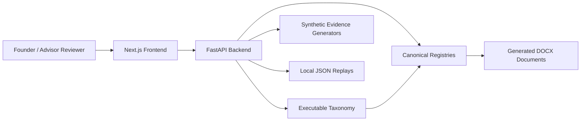
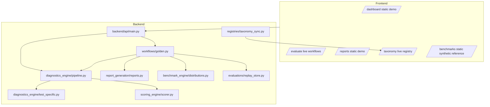
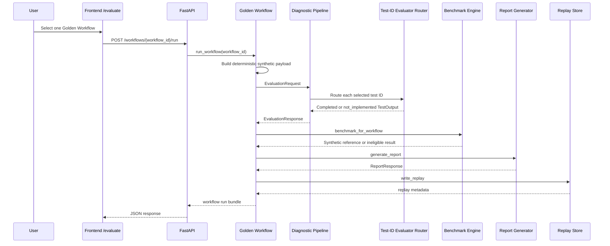
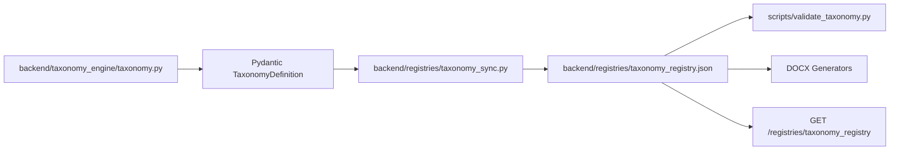

# AI Health Check MVP High-Level Design

## Document Purpose And Status

This High-Level Design describes the implemented Phase 2D state of the Lendingtech AI Health Check MVP. It is an implementation-facing document for maintainers, reviewers, and advisors who need to understand what the repository actually does today.

The source of truth is executable code and canonical registries, not aspirational roadmap text. Future capabilities are identified only in the Future Architecture section.

## Product Scope And Non-Goals

Implemented scope:

- Lendingtech only.
- Product phase: Assisted Intelligence MVP.
- 8 AI systems.
- 5 pillars, including `Data Integrity`.
- 21 Supporting Practices.
- 130 meaningful use cases.
- 520 normalized diagnostic test specifications.
- 24 executable test-specific Phase 2C evaluators across six Golden Workflows.
- Deterministic synthetic demo evidence for workflow execution.
- Local JSON replay artifacts for normal workflow runs.
- Illustrative synthetic benchmark distributions for eligible workflows.
- Next.js frontend for dashboard, workflow execution, reports, taxonomy browsing, and synthetic benchmark review.

Explicit non-goals in the current implementation:

- No customer evidence upload endpoint.
- No arbitrary frontend evaluation builder for user-selected AI system, Pillar, practice, and use case.
- No PostgreSQL-backed production persistence.
- No authentication or authorization.
- No empirical industry benchmark collection.
- No LLM-as-judge evaluator invocation.
- No regulatory certification or compliance attestation.
- No Phase 2C expansion beyond the existing 24 executable tests.

## Taxonomy Model And Invariants

The taxonomy hierarchy is:

```text
Fintech Segment -> AI System -> Pillar -> Supporting Practice -> Use Case -> Test
```

Current invariants:

- AI systems: 8
- Use cases: 130
- Tests: 520
- Light Tests: 390
- Strong Tests: 130
- Tests per use case: 3 Light Tests and 1 Strong Test
- Supporting Practices: 21
- Category A use-case intersections: 104
- Category B use-case intersections: 26
- Orientations: Horizontal and Hybrid only
- No Category C entries
- No Vertical entries
- Pillars: Risk, Reliability, Data Integrity, Explainability, Governance
- Taxonomy identity fingerprint: `d7f9f041248661a6e1bc551c824d9c82bd6668518b5ebca266d1e08fad905b9f`

Every test definition uses the normalized Phase 2B diagnostic schema:

```text
id, name, test_type, objective, inputs_required, preprocessing_steps,
perturbation_strategy, technique, method, primary_metrics, secondary_metrics,
benchmark_interpretation, failure_criteria, recommendation_logic,
implementation_metadata
```

## System Context



The system is local/demo-oriented. It does not ingest customer files or connect to a production data store.

## Component Architecture



## Evaluation Request And Response Sequence



The implemented frontend behavior is workflow-first. Users do not currently construct arbitrary evaluations by choosing an AI system, Pillar, Supporting Practice, and use case in the runner.

## Taxonomy-To-Registry Synchronization Flow



`taxonomy.py` is authoritative. `taxonomy_registry.json` is a deterministic generated representation. Drift is checked with `scripts/sync_taxonomy_registry.py --check`.

## Backend Component Responsibilities

- `backend/api/main.py`: FastAPI routes, CORS setup, registry endpoints, evaluation/workflow/report/benchmark wiring.
- `backend/taxonomy_engine/taxonomy.py`: executable taxonomy construction and reusable diagnostic specification patterns.
- `backend/taxonomy_engine/validation.py`: taxonomy counts, identity fingerprint, schema completeness, registry sync, and registry truth checks.
- `backend/registries/taxonomy_sync.py`: deterministic export and drift detection for `taxonomy_registry.json`.
- `backend/diagnostics_engine/pipeline.py`: validates taxonomy selection and turns selected tests into standardized outputs.
- `backend/diagnostics_engine/test_specific.py`: Phase 2C test-ID evaluator router and 24 deterministic evaluator implementations.
- `backend/scoring_engine/scorer.py`: per-output risk conversion and aggregate score/risk calculation.
- `backend/recommendation_engine/recommender.py`: practice-aware fallback recommendation generation.
- `backend/benchmark_engine/distributions.py`: illustrative synthetic benchmark comparison and benchmark ineligibility behavior.
- `backend/report_generation/reports.py`: founder-readable report and scorecard summary generation.
- `backend/workflows/golden.py`: six Golden Workflow orchestration paths.
- `backend/evaluations/replay_store.py`: local JSON replay writes.
- `backend/synthetic_data/generators.py`: deterministic synthetic evidence payloads.

## Frontend Component And Route Responsibilities

| Route | Data source | Operational behavior | Known limitation |
| --- | --- | --- | --- |
| `/dashboard` | Static demo data | Shows synthetic score, risk, pillar, insight, recommendation, and benchmark widgets | Not live and not persisted customer evidence |
| `/evaluate` | Live backend data | Loads six workflows, lets user select one, runs `POST /workflows/{workflow_id}/run`, displays returned report | Synthetic workflow payloads only; no file upload |
| `/reports` | Static demo data | Shows expanded report viewer using the demo run shape | Live reports are shown after running `/evaluate` |
| `/taxonomy` | Live backend data | Browses `GET /registries/taxonomy_registry` and normalized diagnostic fields | Large registry response rendered client-side |
| `/benchmarks` | Static demo data | Shows illustrative synthetic benchmark view | No empirical peer benchmark data |

## API Surface And Side Effects

Functional endpoints:

- `GET /health`: process health check.
- `GET /registries/{registry_name}`: returns canonical registry JSON.
- `GET /use-cases`: returns taxonomy use cases.
- `GET /tests`: returns taxonomy tests.
- `GET /workflows`: returns workflow registry entries.
- `POST /evaluate`: executes selected taxonomy tests for an explicit request.
- `POST /score`: returns aggregate scoring for an evaluation response.
- `POST /generate-report`: returns a report for an evaluation response.
- `POST /benchmark`: records process-local benchmark values.
- `POST /workflows/{workflow_id}/run`: runs one Golden Workflow.

Side effects:

- `POST /workflows/{workflow_id}/run writes a replay JSON file` under `backend/evaluations/replays` during normal operation.
- `POST /benchmark` writes only to an in-memory process-local benchmark store.
- Registry and taxonomy read endpoints do not persist data.

## Golden Workflow Catalogue

| Workflow ID | AI system | Supporting Practice | Test IDs | Evidence source | Evaluator status | Benchmark eligibility | Replay behavior |
| --- | --- | --- | --- | --- | --- | --- | --- |
| `fraud_adversarial_testing` | Fraud detection AI | Adversarial testing | `fraud-detection-ai-adversarial-testing-lt1`, `fraud-detection-ai-adversarial-testing-lt2`, `fraud-detection-ai-adversarial-testing-lt3`, `fraud-detection-ai-adversarial-testing-st1` | `synthetic_fraud_attacks` | 4 implemented | Eligible for illustrative synthetic fraud robustness benchmark | Writes local replay |
| `credit_bias_mitigation` | Credit scoring AI | Bias mitigation | `credit-scoring-ai-bias-mitigation-lt1`, `credit-scoring-ai-bias-mitigation-lt2`, `credit-scoring-ai-bias-mitigation-lt3`, `credit-scoring-ai-bias-mitigation-st1` | `fairness_sensitive_samples` | 4 implemented | Eligible for illustrative synthetic credit fairness benchmark | Writes local replay |
| `loan_approval_counterfactual_fairness` | Loan approval AI | Fairness of model output | `loan-approval-ai-fairness-of-model-output-lt1`, `loan-approval-ai-fairness-of-model-output-lt2`, `loan-approval-ai-fairness-of-model-output-lt3`, `loan-approval-ai-fairness-of-model-output-st1` | `fairness_sensitive_samples` | 4 implemented | Eligible for illustrative synthetic credit fairness benchmark | Writes local replay |
| `support_llm_harmful_output` | Customer support LLM | Harmful model output | `customer-support-llm-harmful-model-output-lt1`, `customer-support-llm-harmful-model-output-lt2`, `customer-support-llm-harmful-model-output-lt3`, `customer-support-llm-harmful-model-output-st1` | `toxic_conversation_variants` | 4 implemented | Eligible for illustrative synthetic LLM safety benchmark | Writes local replay |
| `default_residual_drift` | Loan default prediction AI | Residual analysis | `loan-default-prediction-ai-residual-analysis-lt1`, `loan-default-prediction-ai-residual-analysis-lt2`, `loan-default-prediction-ai-residual-analysis-lt3`, `loan-default-prediction-ai-residual-analysis-st1` | `synthetic_repayment_drift` | 4 implemented | Eligible for illustrative synthetic residual drift benchmark | Writes local replay |
| `kyc_outlier_diagnostics` | KYC verification AI | Outlier diagnostics | `kyc-verification-ai-outlier-diagnostics-lt1`, `kyc-verification-ai-outlier-diagnostics-lt2`, `kyc-verification-ai-outlier-diagnostics-lt3`, `kyc-verification-ai-outlier-diagnostics-st1` | `noisy_ocr_documents` | 4 implemented | Ineligible; KYC does not fall back to the fraud benchmark | Writes local replay |

## Evidence And Dataset-Origin Model

Evidence origins:

- Synthetic demo generators are executable and used by Golden Workflows.
- Generated perturbation evidence is represented in registries and taxonomy metadata.
- Customer dataset is a planned contract only.
- Public datasets are manifest/planning references unless executable code imports them.
- Benchmark dataset refers to fixed synthetic distributions.

Customer-data upload is not implemented. The frontend upload panel describes evidence contracts but does not send files.

## Test-Specific Evaluator-Routing Model

The pipeline resolves a taxonomy selection to four test IDs. Each test ID is sent to the Phase 2C router in `backend/diagnostics_engine/test_specific.py`.

Routing behavior:

- If a test ID has an `EvaluatorConfig`, the concrete deterministic evaluator runs.
- If a test ID is absent from the router, the result fails closed with `execution_status: not_implemented`.
- No practice-level fallback evaluator is used for unsupported tests.
- The evaluator registry contains conceptual evaluator entries and concrete Phase 2C evaluator entries; only the concrete Phase 2C entries are executable by the router.

## Execution And Evidence Statuses

Execution statuses:

- `completed`: evaluator ran and returned a score.
- `insufficient_evidence`: evaluator exists but the payload is missing, insufficient, or malformed for scoring.
- `not_implemented`: no evaluator is routed for the test ID.
- `failed`: reserved for unexpected execution failures.

Evidence statuses:

- `valid`
- `missing`
- `malformed`
- `insufficient`
- `not_applicable`

## Scoring And Coverage Eligibility

Only outputs with numeric scores are included in aggregate scoring. Unassessable outputs are counted in coverage but excluded from aggregate score calculation.

The scoring engine maps numeric scores to risk levels:

- Low risk: high health score.
- Medium risk: middle health score.
- High risk: low health score.

Strong Tests are selected with Light Tests in Golden Workflows. Unsupported tests do not receive synthetic scores.

## Benchmark Architecture And Eligibility

Implemented benchmark behavior:

- Benchmarks are fixed illustrative synthetic distributions in `backend/registries/benchmark_registry.json`.
- Eligible workflow scores are ranked against the matching synthetic distribution.
- Benchmark output includes eligibility and caveat metadata.
- KYC outlier diagnostics returns benchmark-ineligible output.
- KYC does not fall back to the fraud benchmark.

Not implemented:

- empirical industry benchmarking;
- anonymized customer cohort distributions;
- persistent benchmark tables;
- cross-company benchmark intelligence.

## Reporting And Recommendation Flow

Reports are generated from `EvaluationResponse` objects.

Report behavior:

- scored tests drive aggregate score and risk summary;
- high-risk or weakest scored outputs drive recommendations;
- insufficient, not implemented, and failed tests are surfaced in the scorecard;
- reports state synthetic demo assurance scope;
- report output is not a certification or regulatory approval.

Recommendations come from evaluator outputs when concrete evaluators run and from fallback practice-aware logic for unsupported paths.

## Replay And Persistence Behavior

Normal Golden Workflow runs write local JSON replay artifacts through `backend/evaluations/replay_store.py`.

Validation tests avoid canonical replay writes by monkeypatching `write_replay` to a temporary stub. Existing committed replay examples are not regenerated by the documentation-hardening task.

The running MVP has no production database connection. Benchmark state outside workflow benchmark comparison is process-local and lost on restart.

## Database Status

`backend/schemas/database.sql is a proposed relational schema`. It documents a possible future persistence design, but the running MVP is not wired to PostgreSQL.

Current persistence:

- local JSON replay files for normal workflow runs;
- process-local in-memory benchmark store for `/benchmark`;
- committed JSON registries for static contracts.

## Deployment And Runtime Topology

Local runtime:

- Backend: `python -m uvicorn backend.api.main:app --host 127.0.0.1 --port 8000`
- Frontend: `npm run dev` under `frontend/`
- Frontend API base: `NEXT_PUBLIC_API_BASE_URL`, defaulting to `http://127.0.0.1:8000`

The repository does not define production infrastructure, managed secrets, database services, queues, or object storage.

## Security And Trust Boundaries

Current trust boundaries:

- No customer file upload endpoint.
- No authentication or authorization.
- CORS is configured in the FastAPI app for frontend development access.
- Synthetic evidence is safe for demo execution but is not customer evidence.
- Local replay files may contain payloads used in workflow runs.
- There is no production-grade encryption or key-management layer.
- There is no production persistence layer.
- The platform does not claim regulatory certification.
- Future customer evidence ingestion must avoid storing raw borrower records in benchmark distributions.
- Future benchmark collection must separate aggregate observations from raw prompts, records, labels, and outputs.

## Error Handling

Implemented error behavior:

- Unknown workflow IDs raise API errors.
- Invalid taxonomy selections fail request validation or lookup.
- Missing evaluator routes return standardized `not_implemented` outputs.
- Missing or malformed evidence for routed tests returns `insufficient_evidence` without a score.
- Frontend API helper surfaces fetch failures with endpoint context.

## Observability And Auditability

Current auditability:

- taxonomy identity fingerprint detects structural taxonomy drift;
- deterministic registry check detects exporter drift;
- validation tests verify registry truthfulness and DOCX coverage;
- workflow replay files capture normal Golden Workflow execution outputs;
- generated reports include coverage and unassessable-test categories.

Not implemented:

- centralized logs;
- metrics/trace collection;
- authenticated audit trails;
- immutable evidence provenance store.

## Current Limitations

- Only 24 of 520 tests have concrete executable evaluators.
- The 496 remaining tests are refined specifications but not executable diagnostics.
- Customer upload is not implemented.
- Benchmarks are illustrative synthetic references only.
- `/dashboard`, `/reports`, and `/benchmarks` use static demo data.
- `/taxonomy` renders a large live registry response client-side.
- Local replay writes are filesystem artifacts, not governed production records.
- No authentication, authorization, production persistence, or key management exists.
- Microsoft Word pagination may differ from headless renderers, though explicit styles now constrain layout behavior.

## Future Architecture

Planned future components, not implemented today:

- customer evidence upload and validation;
- persisted evaluation history in a production database;
- empirical benchmark governance and anonymized cohort aggregation;
- LLM-as-judge rubric evaluators;
- external model invocation or model-under-test connectors;
- authentication and organization access control;
- production observability and audit trails;
- cross-company assurance intelligence.

These planned components should not be read as current repository behavior.

## Source-Of-Truth And Generated-Artifact Rules

Source-of-truth hierarchy:

1. `backend/taxonomy_engine/taxonomy.py`
2. Pydantic taxonomy models in `backend/schemas/models.py`
3. deterministic export through `backend/registries/taxonomy_sync.py`
4. generated `backend/registries/taxonomy_registry.json`
5. generated DOCX artifacts

Generated artifacts:

- `docs/Completed_MVP_Product_Taxonomy_Formatted.docx`: complete reference, all 520 normalized specifications.
- `docs/Completed_MVP_Product_Taxonomy_Review_Pack.docx`: compact human-review pack, all 130 use cases and all 520 test IDs.

Do not hand-maintain taxonomy content inside DOCX files. Regenerate them from the canonical generator and registry synchronization path.
